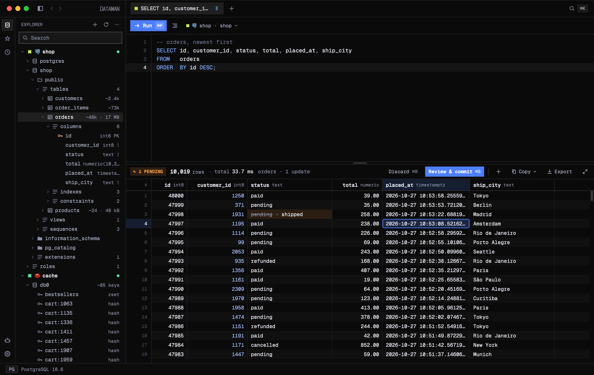

<div align="center">


# Dataman

**The modern open-source database client.**

A fast native GUI for nine databases, written in Rust on [GPUI](https://www.gpui.rs).<br>
Claude Code and any other MCP client can work with your databases through it, and see only what you let them see.

[](https://github.com/brunocapri/dataman/releases/latest)
[](LICENSE)


[**Download for macOS**](https://github.com/brunocapri/dataman/releases/latest) · [Website](https://getdataman.com) · [Release notes](https://github.com/brunocapri/dataman/releases)

<br>



</div>

<br>

## Works with

<table align="center">
  <tr>
    <td align="center" width="96"><br><sub>PostgreSQL</sub></td>
    <td align="center" width="96"><br><sub>MySQL</sub></td>
    <td align="center" width="96"><br><sub>SQL Server</sub></td>
    <td align="center" width="96"><br><sub>SQLite</sub></td>
    <td align="center" width="96"><br><sub>DuckDB</sub></td>
  </tr>
  <tr>
    <td align="center" width="96"><br><sub>MongoDB</sub></td>
    <td align="center" width="96"><br><sub>Elasticsearch</sub></td>
    <td align="center" width="96"><br><sub>OpenSearch</sub></td>
    <td align="center" width="96"><br><sub>Redis</sub></td>
    <td></td>
  </tr>
</table>

SQLite and DuckDB are built in, so they need nothing installed. Every connection can go through an SSH tunnel (agent, key or password, with `~/.ssh/config` aliases and ProxyJump) and over TLS (rustls, no OpenSSL).

## A proper GUI, before anything else

- **Editor**: tabs side by side, schema-aware autocomplete, a lint that catches `UPDATE` without `WHERE` and unknown columns as you type, formatting, find & replace with regex, query parameters, manual transactions. Tabs and unsaved text come back on relaunch.
- **Grid**: edit cells, insert and delete rows. Every change is staged, and **Review & commit** shows the SQL it will run in one transaction. You can sort, filter by value and hide columns, and open JSON in a tree.
- **Foreign key navigation**: click a cell holding a foreign key and choose **Go to "customers"**, and the row it points to opens in a tab of its own (`customers · id = 1250`). From there you can keep following keys.
- **Explorer**: tables, views, materialized and partitioned tables, functions, sequences, enums, triggers, extensions and roles. The DDL comes from the catalog, and SELECT, INSERT, UPDATE and CREATE TABLE are generated for you. There is also a GRANT/REVOKE editor.
- **Plans**: `EXPLAIN` as a tree or a flame graph, with hints for seq scans, spills to disk, misestimates and missing workers. Explain Analyze runs writes inside a transaction that is rolled back.
- **Activity monitor** (PostgreSQL): live sessions, a lock tree showing who blocks whom, and `pg_stat_statements`, with cancel and terminate buttons.
- **NoSQL that feels native**: a mongosh-style shell with real JavaScript for MongoDB, a Dev Tools console for Elasticsearch and OpenSearch, and type-aware views for Redis keys (hash, list, set, zset, stream, JSON).
- **Data in and out**: export to CSV, TSV, JSON, NDJSON, SQL `INSERT` or Parquet. On PostgreSQL you can also import those formats, with types inferred.
- **Keyboard first**: a command palette (`⌘K`) for commands, tables, tabs, favorites and connections, a key map sheet (`⇧⌘/`), and every binding can be changed.
- **History and favorites** per connection, folders for saved queries, `.sql` files and SQLite/DuckDB files opened straight from Finder or the terminal.
- **Dark, light or follow the system**, a translucent window, four mono fonts and zoom from 80 to 200%.

## AI agents (MCP)

Dataman is also an [MCP](https://modelcontextprotocol.io) server. An agent works through your saved connections, and its passwords stay in the system keychain, where the agent never sees them.

When the app is open, every call goes through it, so you watch the agent's queries run in a tab of their own and approve what needs approving.

### Connect an agent

The server is the `dataman-mcp` command, spoken over stdio. Where it is depends on how you installed Dataman:

| Install | Command |
|---|---|
| macOS | `/Applications/Dataman.app/Contents/MacOS/dataman-mcp` |
| Linux, .deb | `/usr/bin/dataman-mcp` |
| Linux, AppImage | the AppImage's path followed by `--mcp`, e.g. `~/Apps/Dataman-x86_64.AppImage --mcp` |
| Built from source | `target/release/dataman-mcp` |

Agents › General in the app shows the exact command for your install, and so does `dataman-mcp --claude`. The examples below use the macOS path; swap in yours.

**Agents with a command line:**

```bash
# Claude Code
claude mcp add dataman -- /Applications/Dataman.app/Contents/MacOS/dataman-mcp

# Codex
codex mcp add dataman -- /Applications/Dataman.app/Contents/MacOS/dataman-mcp

# Gemini CLI
gemini mcp add dataman /Applications/Dataman.app/Contents/MacOS/dataman-mcp

# VS Code (Copilot agent mode)
code --add-mcp '{"name":"dataman","command":"/Applications/Dataman.app/Contents/MacOS/dataman-mcp"}'
```

On Linux with the AppImage, `--mcp` goes after the path: for example, `claude mcp add dataman -- ~/Apps/Dataman-x86_64.AppImage --mcp`.

**Agents configured by a JSON file**: add this to the file, and restart the app.

```json
{
  "mcpServers": {
    "dataman": {
      "command": "/Applications/Dataman.app/Contents/MacOS/dataman-mcp"
    }
  }
}
```

| Agent | File |
|---|---|
| Cursor | `~/.cursor/mcp.json` |
| Claude Desktop | `~/Library/Application Support/Claude/claude_desktop_config.json` |
| Windsurf | `~/.codeium/windsurf/mcp_config.json` |

With the AppImage, use `"command": "/path/to/Dataman-x86_64.AppImage"` and `"args": ["--mcp"]`.

Any other MCP client works the same way: give it the command above as a stdio server. The name the client reports is the one shown in Audit and on the Allow sheet.

### Decide how far it goes, per connection

| Tier | What the agent can do |
|---|---|
| `off` | Nothing. This is the default on production connections. |
| `read` | Read and explore. This is the default everywhere else. |
| `write` | `INSERT`, and `UPDATE` / `DELETE` with a real `WHERE`, up to a row limit. |
| `full` | Destructive statements too, each one waiting for your **Allow** in the app. |

On a production connection, every write waits for your Allow. A read-only database refuses writes no matter what.

### Decide what it sees

Here is the same row as three different agents see it:

| `users` | Data | Masked data | Structure only |
|---|---|---|---|
| **email** | `ana.ribeiro@acme.co` | `a•••@acme.co` | `text` |
| **phone** | `+55 11 9912 0034` | `+•• •• •••• 0034` | `text` |
| **plan** | `pro` | `pro` | `plan_t` |
| ~~password_hash~~ | *not a column* | *not a column* | *not a column* |

You can hide tables, schemas and columns from agents entirely. Columns you mark sensitive are masked whole before any value is read, and they can still be filtered as they are. Cards, e-mails, phones, keys, tokens and password hashes found inside any other value are masked too. Every call is written to an audit log, without passwords or bound values. An edit to the config files made outside Dataman that loosens any of this, including one made by an agent with a shell, waits for your review.

Every setting is explained one by one in [Agent settings in detail](#agent-settings-in-detail).

## Agent settings in detail

### TL;DR: recommended settings

[Skip the TL;DR ↓](#where-the-settings-live)

**Out of the box**, every connection is on the read tier and the agent sees the data as it is. A connection tagged production starts with agents off. Nothing is hidden or masked until you say so.

Start from the row that matches each connection:

| Connection | Tier | The agent sees | Also |
|---|---|---|---|
| **Your local database** | write | Data | Use full only when you want the agent to change the schema. Each change still waits for your Allow. |
| **Shared dev / staging** | write | Data | Safe writes run, and anything past 100 rows waits for your Allow. Destructive statements are refused. |
| **Production, to debug with real data** | read | Masked data | Tag it production, click **Scan again** to mark sensitive columns, and hide secrets and credential tables outright. |
| **Production, to write queries only** | read | Structure only | The agent sees tables, columns and plans, writes the query, and you run it yourself. |
| **Anything you don't want agents near** | off | | Agents don't even see the connection's details. |

Two habits help on top of any of these:

- **Give agents a connection of their own**, saved with a database user that can only read what they need. Dataman's rules are a second wall; the database's own permissions are the first.
- **Check Audit now and then.** It shows every call, what was refused and exactly what the agent received.

### Where the settings live

Everything below lives in the **Agents** window: **General**, **Audit**, **Permissions** and **Privacy** (with **Sensitive data** under it). Permissions and Privacy are set per connection. General and Sensitive data apply to every connection.

### How a call is decided

Every call goes through these checks in order. The first one that refuses wins, and nothing further down can loosen what an earlier one decided.

1. **Agent access is off.** Nothing runs.
2. **The connection's tier is off.** Nothing runs on it.
3. **The database is read-only.** No write runs, whatever the tier.
4. **Privacy.** Hidden objects are refused, and queries are narrowed and masked before any tier decision.
5. **Production.** Every write waits for your Allow.
6. **The tier.** Read refuses writes, write runs safe writes within the row limit, and full asks before destructive ones.

Nothing the agent sends can change this. There is no argument an agent can pass to skip a check.

### General

**Agent access** (default: on). This is the master switch, the same one as Settings › MCP.

- **Off:** every agent call is refused with `MCP access is turned off in Dataman (Settings › MCP)`. Agents still see the list of tools, but every connection, favorite and resource is gone for them.
- If a program turns it back on by editing `settings.toml`, the change waits for your review.

**Connect an agent.** Shows the stdio command to give your MCP client, with a Copy button.

**Settings file: Export… / Import…** saves every agent rule to a `dataman-agents.toml` file, or loads one.

- **Included:** agent access, sensitive data types, and per connection its tier, row limit and all its Privacy and Permissions rules.
- **Never included:** passwords, hosts, ports, users, SSH settings, the masking key and the audit.
- **On import:** connections are matched by id, or else by name and engine. Ones not found are listed as left out. Before anything applies, a summary shows what would give agents more access. The whole file is applied at once and written to the audit.

### Permissions

#### MCP tier

| | Off | Read | Write | Full |
|---|:-:|:-:|:-:|:-:|
| Explore schemas, run reads | | ✓ | ✓ | ✓ |
| `INSERT`, and `UPDATE` / `DELETE` / `MERGE` with a real `WHERE`, within the row limit | | | ✓ | ✓ |
| Writes over the row limit | | | asks | asks |
| Destructive statements | | | | asks |

**Default:** read. On a connection tagged production it is off, unless you chose a tier yourself.

**Off.** The connection still appears in the agent's list, showing only its name, environment and engine. Nothing runs on it, its favorites are hidden, and agents cannot edit it.

**Read.** Every read runs in a read-only transaction that is always rolled back.

- **Runs:** `SELECT`, `WITH … SELECT`, `TABLE`, `VALUES`, `SHOW` and `EXPLAIN`, plus MySQL `DESCRIBE`, the DuckDB `DESCRIBE` / `SUMMARIZE` / `PIVOT` forms, and report-only `PRAGMA`s.
- **Refused:**
  - row locks (`FOR UPDATE`, `FOR SHARE`, `LOCK IN SHARE MODE`);
  - CTEs that write, `SELECT … INTO`, `COPY`, `CALL`, `DO` and `SET`;
  - transaction control (`BEGIN`, `COMMIT`, `SAVEPOINT`);
  - functions with side effects, such as `nextval`, `setval`, advisory locks, `dblink`, `pg_read_file`, `set_config`, `load_file` and `openrowset`.
- **Also:** `EXPLAIN ANALYZE` counts as the statement it runs, so `EXPLAIN ANALYZE SELECT` passes and `EXPLAIN ANALYZE DELETE` does not. The `explain` tool shows the plan of any statement without running it, so it only needs read.

**Write.** Adds the safe writes: `INSERT`, `UPDATE`, `DELETE`, `MERGE` and `REPLACE`.

- **A real `WHERE`.** `UPDATE` and `DELETE` need a `WHERE` that can be false. `WHERE 1=1`, `WHERE true`, `'a'='a'`, `col = col` and any condition with an always-true `OR` branch count as no `WHERE`, which makes the statement destructive. `MERGE` is destructive when it has no `ON`, an always-true `ON`, or `WHEN NOT MATCHED BY SOURCE`. Any other condition that names a column counts as real, even `id > 0`, so the row limit is the backstop for those.
- **Row limit** (default 100 rows). The limit counts every row changed by the whole call, not per statement. The write runs in a transaction, and if it changed more rows than the limit, it is rolled back and you are asked. Your Allow shows the count and up to 5 of the changed rows. When it runs again, it commits only if it changes no more rows than you saw.
- **Scripts.** All the statements of one call run in one transaction, committed only if every one succeeds. A statement that cannot run inside a transaction (`VACUUM`, `CREATE INDEX CONCURRENTLY`) must come alone.
- **Destructive statements are refused** on this tier, with a message saying they need full.

**Full.** Destructive statements can run too, but each one waits for your **Allow**. Destructive means:

- any DDL (`CREATE`, `ALTER`, `DROP`, `COMMENT`), and `GRANT` / `REVOKE`;
- `TRUNCATE`, `CALL`, `DO`, `EXEC`, `COPY`, `LOAD DATA`, `BULK INSERT`, `VACUUM` and side-effect functions such as `pg_terminate_backend()`;
- `UPDATE` / `DELETE` without a real `WHERE`, and an unbounded `MERGE`;
- anything Dataman cannot classify.

Statements that only change rows are run first, counted and rolled back, and then you are asked. Everything else is asked before it runs at all.

**The Allow sheet** shows the connection, database, environment (in red on production), which agent is asking, the SQL, why it is asking, and for counted writes, how many rows and a preview of them.

- **Deny** (`esc`): the agent is told it was denied, and it cannot ask again for 5 seconds.
- **Allow** (`⌘↩`): only clickable after 600 ms, so a stray keypress cannot approve anything. It turns red on production or for a destructive statement.
- **No answer:** after 120 seconds the request is dropped and nothing runs.
- **Queue:** at most 3 questions can wait per agent, and 8 in total.

#### Production

Tag a connection as **production** in its settings to change what agents can do there:

- Every write waits for your Allow, even a one-row `INSERT` on the write tier.
- The default tier becomes off.
- `cancel_backend` asks as well.
- **No effect on reads.**
- The dev and staging tags change nothing for agents.

#### Read-only

A connection, or a single database in it, marked read-only refuses every write from agents, on every tier. Reads and drafts still work. Agents cannot turn read-only off.

#### Agents may

All three are checked by default. Unchecking one means **never, even with your Allow**.

| Option | Needs | Covers |
|---|---|---|
| **Change structure** | full | DDL: tables, indexes, views, grants… |
| **Run code** | full on SQL, read on NoSQL | procedures, `DO` blocks, MongoDB `$where` / `$function` / `mapReduce`, Elasticsearch scripts and runtime fields |
| **See server activity** | read | `activity_sessions`, `activity_locks`, `cancel_backend`, `terminate_backend` (PostgreSQL) |

See server activity is forced off while Privacy hides or masks anything, because sessions show other people's queries.

**Redis** shows its command categories instead. `@read`, `@write`, `@keyspace`, `@scripting` and `@pubsub` are on by default. `@dangerous` (`FLUSHALL`, `CONFIG`, `KEYS`, `SHUTDOWN`, `ACL`, `MODULE`, `DEBUG`…) never runs for agents. The tier still applies on top: writes need write, and scripts need full and your Allow.

**MongoDB** adds **Read from**: primary (default), prefer secondary, or secondary. This choice applies only to agents' reads.

#### Limits

| Limit | Default | Choices | When it is reached |
|---|---|---|---|
| **Time per call** | 5 min | 10 s, 30 s, 2 min, 5 min | The call fails as timed out and returns no rows. This is a ceiling: agents ask for 30 s unless they ask for more. |
| **Rows per write** | 100 | 10 to 10k | Rolled back, then you are asked (see Write above). |
| **Rows per read** | 1k | 20 to 1k | The result is cut, with a note telling the agent more rows exist. |
| **Size per read** | 256 KB | 16, 64, 256 KB | The result is cut there. Single cells over 2,000 characters are always shortened. |

At most 2 agent statements run at once per connection, and 8 in total.

#### The server's files and programs

Anything that reaches the files or programs on the database server always waits for your Allow on full, and is refused below full:

- **PostgreSQL:** `COPY` to or from a file or `PROGRAM`, `ALTER SYSTEM`, `LOAD`, and the large-object and file functions.
- **MySQL:** `INTO OUTFILE`, `DUMPFILE` and `LOAD DATA INFILE`.
- **SQL Server:** `BULK INSERT`, `BACKUP`, `RESTORE`, `OPENROWSET`, `xp_cmdshell` and the other `xp_` / `sp_oa` procedures.

SQLite and DuckDB never let an agent touch other files, not even with your Allow: `ATTACH`, `COPY`, `INSTALL` / `LOAD`, `read_csv` / `read_parquet` / `read_json`, file paths in place of tables, and the scanners for other databases are all refused.

### Privacy

#### The agent sees

**Default:** Data.

**Data.** Rows come back as the table holds them. Visible to agents still hides what it hides, and database errors never quote values, in every mode.

**Masked data.** On top of Data:

- **Sensitive columns** are replaced whole, by column name.
- **Sensitive data types** are searched for in every other value of every reply, including errors and JSON keys, and masked where they are found. Each reply tells the agent how many values of each type were masked, as `masked: {"E-mail": 1}`.
- **Hidden connection details:** `list_connections` no longer shows the host, port, user or SSH settings.
- **No server activity.** It is turned off for agents.

**Structure only.** No rows, ever.

- **What agents get:** names, types, keys, indexes, constraints, triggers, the DDL and `EXPLAIN` plans.
- **Refused:** any statement that reads or writes rows, through any tool (`run_query`, `sample_rows`, `explain_analyze`, `execute`, `open_query`, favorites and your own tools). A plain `EXPLAIN` still runs, and so does DDL when Change structure allows it.
- **What still shows:** estimated row counts and table sizes, column defaults, check constraints, comments, function bodies and enum values, since all of that is structure.

#### Visible to agents

**Default:** Everything except, with an empty list.

- **Everything except:** the list holds what is hidden, and tables created later are visible.
- **Only these:** the list holds what agents can see, and everything else is hidden, including tables created later.
- **Column entries** are always hidden, in both modes.

| Engine | Write entries as | Examples |
|---|---|---|
| SQL | `schema.*`, `table`, `schema.table`, `table.column` | `billing.*`, `users.ssn` |
| MongoDB | `collection` or `collection.field` | `users.ssn` |
| Elasticsearch / OpenSearch | `index` or `index.field` | `logs-*` |
| Redis | a key pattern, or `key.field` for hash fields | `session:*` |

`*` matches anything, and case is ignored.

What happens to hidden things:

- **Hidden tables and schemas:** they are left out of every listing, search and resource. A query that names one is refused with `` `x` is not visible to agents on `conn` ``.
- **Hidden columns:** the table is quietly replaced with only its visible columns, so `SELECT *` and `row_to_json(t)` never include them. Naming a hidden column anywhere (in the select list, `WHERE`, `JOIN`, `ORDER BY` or a function) is refused. So are writes that would touch it through `*`, `RETURNING *` or an `INSERT` without a column list.
- **Other ways around it:** while anything is hidden or masked on a connection, Dataman refuses whatever could reach that data some other way:
  - views that read it (followed through views of views), user functions and procedures, catalog tables;
  - dynamic SQL and `dblink`, queries on another database;
  - writes to tables with triggers;
  - statements it cannot follow.
  - Generated columns are protected as strongly as the columns they are computed from.
- **NoSQL:**
  - MongoDB strips hidden fields from documents at any depth, and refuses `$$ROOT`, `$where` and database commands.
  - Elasticsearch refuses SQL, ES|QL and searches across all fields.
  - Redis drops hidden keys from `SCAN` and `KEYS`, and refuses `EVAL`, `SORT` and `DUMP`.

> **The limit:** Dataman reads the SQL an agent sends, and refuses what it cannot follow. But copies of the data in other tables, and functions that read it for the agent, can still reach it. Only the database's own permissions block everything. For a hard wall, connect agents with a database user that cannot read the data.

#### Sensitive columns

These apply only when the agent sees **Masked data**.

- **Which columns:** only the ones in this list. Dataman never decides by itself which column is sensitive.
- **Scan again** suggests entries from column names: `password`, `token` and `api_key` as Hidden; `ssn`, `cpf`, `passport` and `iban` as Hash; `email`, `phone`, `birth`, `salary` and `address` as Partial. Nothing is added until you add it.
- **Entry format:** `table.column`, `schema.table.column`, or a pattern such as `*ssn*` to match the column in any table.

| Mask | Example | Notes |
|---|---|---|
| **Hidden** | `‹hidden›` | |
| **Partial** | `a•••@acme.co`, `+•• •• •••• 0034` | Values with fewer than 8 letters and digits become all dots. |
| **Hash** | `‹h:K7QF2MZXWA›` | The same value always gives the same code, so an agent can still match and count rows. The key is random per install and kept in the Keychain. |

**What an agent can do** with a masked column:

- select it under its own name, and it comes back masked;
- compare it in `WHERE` or `ON`, for example `WHERE email = 'ana@acme.co'`.

**What it cannot do:** rename it, compute with it (`upper()`, `substring`, casts, `||`, JSON functions), aggregate it, group or sort by it, or copy it into another table. Writes containing masked text (`‹` or `•`) are refused, so a masked value can never be written back over the real one.

> **What masking does not stop:** filters can still probe a value, for example `WHERE email LIKE 'a%'` or a `BETWEEN` on a salary. Masking keeps values out of replies. To keep a column out of reach entirely, hide it.

### Sensitive data

These are value patterns searched in every reply, on every connection where the agent sees Masked data. One list covers every connection.

| Type | Default | Mask | How it is found |
|---|---|---|---|
| Card number | on | Partial `•••• 4242` | 13–19 digits passing the Luhn check, with a known issuer prefix |
| E-mail | on | Partial | |
| Phone | on | Partial, last 4 kept | US/Canada formats. A bare 10-digit number counts only when it stands alone in text. |
| JWT | on | Hidden | `eyJ….eyJ…` |
| API keys | on | Hidden | AWS, GitHub, Slack, Stripe, Anthropic, OpenAI, Google and GitLab key formats |
| Private keys | on | Hidden | `BEGIN … PRIVATE KEY` blocks |
| Password hash | on | Hidden | bcrypt, argon2, scrypt, pbkdf2, crypt |
| IP address | off | Hash | IPv4 and IPv6 |

You can turn built-ins off, change their masks, and add up to 50 types of your own:

- **Pattern:** a regex. Look-around and back-references are not supported. A named group `v` masks only that part.
- **Validator:** optional. Luhn, IBAN, or "looks random" (high entropy).
- **Test lines:** paste sample values to try the pattern, and Dataman warns when it matches too much.

Values shorter than 5 characters are never checked. A reply that cannot be checked within 100 ms is refused rather than sent unchecked. A custom pattern that is broken and switched on refuses every read on Masked connections until you fix it.

### Audit

Every agent call is written to `~/.config/dataman/mcp-audit.jsonl`. What the agent received, after masking, goes to `mcp-replies.jsonl` next to it. Both files are readable only by you.

- **Recorded:** time, agent, tool, connection and database, the statement, how long it took, how many rows, and the outcome (ran, refused, denied, timed out, failed). Also recorded: your decision on any Allow, the rewritten statement if Privacy narrowed it, and which columns and how many values were masked.
- **Never recorded:** passwords, which show as `••••••` even inside statements, bound parameter values, and values quoted in database errors.
- **Size:** past 8 MB, the log rolls over once, so it never grows past about 16 MB.
- **Clearing:** only from the Audit screen. You can clear everything, everything before a date, or everything older than 30 days, 3 months or 6 months. No agent tool can clear it.

The Audit screen shows the latest calls, filtered by agent, connection, outcome and time. For each call it shows the statement, the rewrite, the decision and exactly what the agent received, with a button to open the statement in a tab.

### Agent tabs and drafts

When the app is open, an agent's `open_query` runs in a tab of its own, one per agent and connection, so you see what it ran and the full result. A read runs in that tab's own read-only transaction and never touches your tabs. The agent tab is reused only when it is idle and unchanged. Otherwise a new tab opens in the background, without taking focus.

With `run: false`, the agent only places the statement in a tab for you to review and run yourself. Drafts work on every tier except off, even on read-only databases.

### When Dataman is closed

The MCP server also runs without the app.

- **What still works:** reads, the catalog tools, and writes that need no question.
- **Refused before anything runs:** anything that needs your Allow (destructive statements, production writes, server files), drafts, and importing favorites. The agent is told to open the app and try again. A write over the row limit is counted, rolled back and refused the same way.

### Connections and favorites made by agents

- **`create_connection`:** agents can add connections, with a tier of off or read only. They can never set write or full, the row limit or any Privacy rule.
  - Passwords go straight to the Keychain and are never returned to any agent.
  - A new connection is refused when a protected one already reaches the same server and user.
- **`update_connection`:** can only tighten. It can raise TLS or the environment tag and lower the tier, but it can never turn read-only off. Pointing a connection at another host, port, user, SSH tunnel or file waits for your Allow, and the saved password is dropped.
- **Projects:** agents leave the connections and favorites of an open project alone. What agents create never syncs into the project file.
- **`run_favorite`:** runs a favorite by name. Names are compared without accents, punctuation or look-alike letters (Cyrillic `а` against Latin `a`). If two favorites come close, nothing runs and the agent gets the candidates.

### Edits made outside Dataman

The rules you approved are also kept in the system Keychain, where only Dataman reads them.

- **Held for review:** another program (an agent with a shell, for one) edits `connections.toml` or `settings.toml` in a way that gives agents more, or that points a connection somewhere else. Your approved rules keep applying meanwhile. A new connection added that way stays out of the explorer until you apply it.
- **Applied at once:** edits that only tighten.
- **Review:** a sheet lists what changed, with **Not now** and **Apply anyway**. The palette command **Review edits made outside Dataman** brings it back.

### Projects and agent rules

With `agents` shared in a project's `[share]` table, each connection's tier and Privacy and Permissions rules travel with the project, along with the sensitive data types.

- **A project file that loosens anything or moves a connection is held whole** until you review it. Tightening applies at once.
- **A moved connection** leaves its saved password behind.
- **Never synced through:** a project folder that is a symbolic link, and database files outside the folder.

### Your own tools

Write parameterized tools in `~/.config/dataman/mcp-tools.toml`, and agents get them as regular tools. The file is reloaded when it changes.

```toml
[[tool]]
name = "orders_by_customer"
description = "A customer's latest orders, newest first."
connection = "shop"
sql = "SELECT id, total FROM orders WHERE customer_id = $1 AND status = $2 ORDER BY id DESC"
max_rows = 50

[[tool.param]]
name = "customer_id"
type = "int"
min = 1

[[tool.param]]
name = "status"
type = "enum"
values = ["open", "paid"]
default = "open"
```

Parameters are typed (`string`, `int`, `number`, `bool` or `enum`, with min, max and length checks) and always bound, never pasted into the SQL. A tool with `mode = "read"` (the default) must be a read. One with `mode = "write"` goes through the same tier, production, row limit and Allow as any other write. A custom tool never gets more than the connection already allows.

## Projects

Commit a `.dataman/project.toml` next to your code, and the team shares connections (never passwords), favorite queries, agent rules and formatting. It stays in sync with each person's local settings.

## Install

| Platform | How |
|---|---|
| **macOS** 11+ (Apple silicon) | [Download the .dmg](https://github.com/brunocapri/dataman/releases/latest). It is signed, notarized and updates itself. |
| **Linux** x86_64 / arm64 | AppImage and .deb packages are coming to the releases. Until then, build from source. |
| **Windows** | Not yet. |

Updates are signed with ed25519 and checked before they install, and a downgrade is refused.

## Build from source

You need Rust 1.99 or newer. On Linux, you also need the GPUI dependencies: `clang`, `lld`, `cmake`, `pkg-config`, the libxkbcommon, Wayland, X11/xcb, fontconfig and freetype headers, and a Secret Service such as gnome-keyring for saved passwords.

```bash
git clone https://github.com/brunocapri/dataman
cd dataman
cargo run --release -p dataman
```

```bash
cargo test --release --workspace         # unit and integration tests
cargo run --release -p xtask -- e2e      # end-to-end on every engine (needs Docker)
```

`scripts/bundle.sh` builds the macOS app and `scripts/linux/build.sh` builds the AppImage and the .deb.

<details>
<summary><b>Where things live</b></summary>

<br>

| | |
|---|---|
| Config | `~/.config/dataman/` (or `$XDG_CONFIG_HOME/dataman`): `connections.toml`, `settings.toml`, `favorites.toml` and `mcp-tools.toml` |
| Passwords | macOS Keychain / Linux Secret Service, under the service name `dataman` |
| Agent audit | `~/.config/dataman/mcp-audit.jsonl` |
| Logs | `~/Library/Logs/Dataman` on macOS, `$XDG_STATE_HOME/dataman/logs` on Linux |
| Project | `<your repo>/.dataman/project.toml` |

`mcp-tools.toml` defines your own parameterized SQL tools for agents. It is reloaded whenever it changes.

</details>

## License

[MIT](LICENSE) © Bruno Capriglioni
